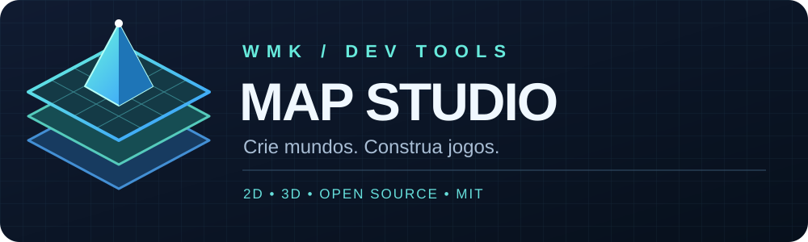

<p align="center"></p>

# WMK Map Studio

Editor independente de mapas para desenvolvedores de jogos. Crie mundos, construa jogos!

**Autor:** Walney Moreira Klein — [walneyk@hotmail.com](mailto:walneyk@hotmail.com)

**Licença:** [MIT](LICENSE) | **Idioma:** Português (Brasil)

## Visão

Ferramenta web modular, sem depender de Unity, Godot ou Unreal. O objetivo é compartilhar mapas, assets e perfis de entidades entre diferentes jogos.

## Versão 0.2.0

A distribuição desenvolvida anteriormente inclui edição 2D em Canvas, pincel, borracha, camadas, spritesheets PNG/WebP, zoom, pan, histórico e persistência JSON. A importação de GLB, terreno 3D, Tiled e triggers visuais permanecem no planejamento.

## Instalação da distribuição

Requer Node.js 22 ou superior. Na pasta do código-fonte, execute:

```powershell
npm install
npm run dev
```

No Windows, também é possível executar INICIAR.bat. Abra o endereço indicado pelo Vite. Testes: npm test. Build: npm run build.

## Estado da publicação

Este repositório inicia com identidade visual e licença. O código da distribuição 0.2.0 deverá ser importado para completar a publicação.

## Roadmap

1. Fundação, projetos, histórico e persistência.
2. Editor 2D: tiles, spritesheets e camadas.
3. Objetos, colisões, regiões e compatibilidade Tiled.
4. Editor 3D: GLB, gizmos e hierarquia.
5. Terrenos, estradas e vegetação.
6. Triggers visuais, perfis e runtime de teste.

## Contribua

Abra uma issue descrevendo a sugestão ou erro, com passos de reprodução e versão. Pull requests são bem-vindos. Preserve os avisos de licença e autoria. Assets de terceiros podem ter licenças próprias.
