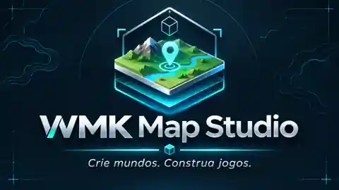

<p align="center"></p>

# WMK Map Studio v0.2.1

**Crie mundos. Construa jogos.**

Editor independente de mapas para desenvolvedores de jogos, gratuito e de código aberto.

**Autor:** Walney Moreira Klein — [walneyk@hotmail.com](mailto:walneyk@hotmail.com)  
**Licença:** [MIT](LICENSE) | **Idioma:** Português (Brasil)

## Recursos atuais

- Projetos e mapas JSON versionados, autosave e recuperação.
- Editor 2D Canvas: pincel, borracha, camadas, spritesheets PNG/WebP, zoom, pan e histórico.
- Painéis redimensionáveis e reposicionáveis em grade.
- Exemplo de vila com três camadas.
- Metadados de mapas 3D (renderização 3D ainda planejada).

## Instalação

Baixe o código pelo botão Code → Download ZIP ou clone o repositório. Instale Node.js 22 ou superior. No Windows, execute INICIAR.bat ou use:

```powershell
npm install
npm run dev
```

Abra a URL exibida pelo Vite. Use Chrome ou Edge para salvar diretamente; em outros navegadores o download não confirma a gravação. Não abra index.html diretamente.

## Primeiro mapa

Abra `exemplos/vila.project.json` pelo botão Abrir JSON. Selecione uma camada e um tile; pinte com o botão esquerdo. Scroll altera o zoom; botão central move a câmera. Ctrl+Z desfaz, Ctrl+Y refaz e Ctrl+S salva.

## Documentação

- [Manual em português](manuais/manual.html)
- [Planejamento original](manuais/planejamento.md)
- [Roadmap](roadmap.html)

## Desenvolvimento

`npm test` executa os testes do núcleo. `npm run build` empacota a aplicação com Vite após instalar dependências.

O núcleo fica em src/core, os formatos em src/formats e as ferramentas 2D em src/editors/2d. O projeto não depende de Godot, Unity ou Unreal.

## Limitações

Canvas 2D nativo; PixiJS e Three.js ainda não integrados. O layout usa grade, não docking completo. Spritesheets de até 1 MB são incorporadas ao JSON; autosave localStorage tem cota e guarda uma única cópia. Validação visual no navegador ainda necessária. Não execute código arbitrário de mapas.

## Roadmap

1. Fundação e persistência.
2. Editor 2D: seleção, copiar/colar e preenchimento.
3. Objetos, colisões, regiões e compatibilidade Tiled.
4. Editor 3D, GLB e gizmos.
5. Terrenos, estradas e vegetação.
6. Triggers visuais e perfis de jogos.

## Contribua

Abra uma issue com versão, passos de reprodução, comportamento esperado e observado. Pull requests são bem-vindos. Preserve os créditos e avisos de licença. Dependências e assets de terceiros conservam suas licenças.
